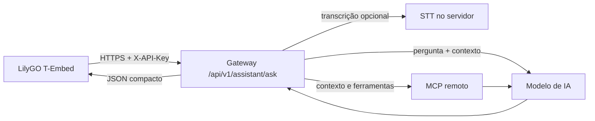

# Gateway de IA do Estêvão

Este documento descreve o serviço separado que deve atender o LilyGO em:

```text
POST https://api.caminhoanglicano.com.br/api/v1/assistant/ask
```

O dispositivo conhece somente essa API, uma API key própria e o certificado
de confiança HTTPS. Credenciais da OpenAI, do MCP remoto ou de qualquer outro
provedor nunca devem ser gravadas no firmware nem enviadas ao LilyGO.



## Responsabilidade do gateway

O gateway deve:

1. autenticar a API key do dispositivo;
2. validar o formato e os limites da requisição;
3. transformar áudio em texto quando a pergunta for por voz;
4. montar o contexto litúrgico solicitado;
5. chamar o MCP remoto e/ou o modelo de IA usando credenciais somente do
   servidor;
6. normalizar a resposta para o formato pequeno e estável esperado pelo
   firmware;
7. aplicar timeout, rate limit, logs operacionais e tratamento de erros.

O MCP remoto é uma dependência interna do gateway. Ele não substitui o
endpoint HTTP que o LilyGO consome.

## Autenticação

Toda chamada válida deve conter:

```http
X-API-Key: estevao_device_...
```

Recomendações:

- usar uma chave diferente por dispositivo ou por instalação;
- armazenar no servidor apenas um hash ou referência segura da chave;
- permitir revogação e rotação sem alterar o firmware;
- nunca aceitar a chave em query string;
- nunca registrar a chave completa em logs;
- responder `401` para chave ausente, inválida ou revogada;
- aplicar rate limit por chave e por endereço de origem.

A API key do LilyGO autentica o dispositivo perante o gateway. Ela não deve
ser a chave da OpenAI nem o token do MCP.

## Headers

### Pergunta por texto

```http
POST /api/v1/assistant/ask
Accept: application/json
Content-Type: application/json
X-API-Key: estevao_device_...
User-Agent: Estevao-LilyGO/0.1
```

### Pergunta por voz

```http
POST /api/v1/assistant/ask
Accept: application/json
Content-Type: audio/wav
X-Question-Mode: voice
X-API-Key: estevao_device_...
User-Agent: Estevao-LilyGO/0.1
```

O gateway deve aceitar somente HTTPS. Não usar `setInsecure()` no firmware nem
oferecer uma rota HTTP pública para esse endpoint.

O firmware já embute a CA raiz `ISRG Root X1` da Let’s Encrypt, usada para
validar `api.caminhoanglicano.com.br`. Não é necessário provisionar um arquivo
de CA no LilyGO. O caminho `/estevao/ca.pem` continua disponível apenas como
override opcional para uma futura troca controlada de cadeia TLS. A fonte
oficial do PEM é <https://letsencrypt.org/certs/isrgrootx1.pem>.

## Contexto da pergunta

O firmware envia o contexto nos parâmetros da URL:

| Parâmetro | Exemplo | Obrigatório | Observação |
| --- | --- | --- | --- |
| `date` | `2026-08-04` | sim | Data litúrgica solicitada, em ISO 8601 |
| `language` | `pt-BR` | sim | Idioma da resposta |
| `prayer_book_code` | `loc_2015` | sim | Livro/plano litúrgico |
| `bible_version` | `nvi` | sim | Versão bíblica preferida |
| `reading_type` | `semicontinuous` | sim | Tipo de seleção das leituras |

Na chamada de texto, o mesmo contexto também aparece no JSON. Isso é feito
para manter a requisição legível e compatível com futuras versões do cliente.
Na chamada de voz, o contexto fica na URL e o corpo é exclusivamente o WAV.

Se um campo repetido no JSON e na URL divergir, o gateway deve responder `400`
com `context_mismatch`, em vez de escolher silenciosamente um dos valores.

Validações mínimas:

- `date` deve ter o formato `YYYY-MM-DD` e ser uma data real;
- `language` deve ser uma opção permitida, inicialmente `pt-BR`;
- os códigos de livro, Bíblia e leitura devem estar em uma allowlist do
  serviço;
- a pergunta de texto não pode ser vazia e deve ter limite de tamanho;
- parâmetros desconhecidos podem ser ignorados ou rejeitados, mas esse
  comportamento deve ser consistente.

## Pergunta por texto

O corpo esperado é:

```json
{
  "question": "Qual é a celebração principal de hoje?",
  "date": "2026-08-04",
  "language": "pt-BR",
  "prayer_book_code": "loc_2015",
  "bible_version": "nvi",
  "reading_type": "semicontinuous"
}
```

Exemplo de chamada:

```bash
curl --fail-with-body \
  -X POST \
  'https://api.caminhoanglicano.com.br/api/v1/assistant/ask?date=2026-08-04&language=pt-BR&prayer_book_code=loc_2015&bible_version=nvi&reading_type=semicontinuous' \
  -H 'Accept: application/json' \
  -H 'Content-Type: application/json' \
  -H 'X-API-Key: <chave-do-dispositivo>' \
  -H 'User-Agent: Estevao-LilyGO/0.1' \
  -d '{
    "question": "Qual é a celebração principal de hoje?",
    "date": "2026-08-04",
    "language": "pt-BR",
    "prayer_book_code": "loc_2015",
    "bible_version": "nvi",
    "reading_type": "semicontinuous"
  }'
```

## Pergunta por voz

O LilyGO grava um WAV mono, PCM signed 16-bit, 48 kHz. O arquivo é enviado
diretamente no corpo da requisição:

```bash
curl --fail-with-body \
  -X POST \
  'https://api.caminhoanglicano.com.br/api/v1/assistant/ask?date=2026-08-04&language=pt-BR&prayer_book_code=loc_2015&bible_version=nvi&reading_type=semicontinuous' \
  -H 'Accept: application/json' \
  -H 'Content-Type: audio/wav' \
  -H 'X-Question-Mode: voice' \
  -H 'X-API-Key: <chave-do-dispositivo>' \
  -H 'User-Agent: Estevao-LilyGO/0.1' \
  --data-binary '@question.wav'
```

O gateway deve:

1. validar RIFF/WAVE, codec PCM, mono, 48 kHz, 16 bits e duração máxima;
2. rejeitar arquivo vazio, truncado ou acima do limite com `422`;
3. transcrever o áudio no servidor;
4. tratar a transcrição como a pergunta textual da mesma pipeline;
5. não devolver áudio nesta versão — a resposta volta como texto JSON para ser
   exibida no display.

O limite recomendado para o MVP é 8 segundos. Em 48 kHz, mono e 16 bits, o
áudio bruto fica próximo de 768 kB, portanto o gateway deve configurar um
limite de corpo um pouco maior, por exemplo 1 MB, sem aceitar uploads
arbitrariamente grandes.

## Pipeline interno sugerido

Depois da validação, o serviço pode normalizar a entrada para algo semelhante
a:

```json
{
  "request_id": "req_01J...",
  "device_id": "lilygo-01",
  "source": "text",
  "question": "Qual é a celebração principal de hoje?",
  "date": "2026-08-04",
  "language": "pt-BR",
  "prayer_book_code": "loc_2015",
  "bible_version": "nvi",
  "reading_type": "semicontinuous"
}
```

A execução deve seguir esta ordem:

1. autenticar e identificar o dispositivo;
2. gerar `request_id` e iniciar o timeout total;
3. validar contexto e limites;
4. transcrever voz, se necessário;
5. consultar as fontes litúrgicas autorizadas pelo MCP;
6. enviar pergunta, contexto e dados recuperados ao modelo;
7. limitar e normalizar a resposta;
8. devolver JSON ao dispositivo.

O prompt interno deve orientar o modelo a responder em `language`, respeitar a
data e as preferências recebidas, priorizar os dados retornados pelas
ferramentas e admitir quando não houver informação suficiente. A pergunta do
usuário é dado não confiável: ela não pode alterar as regras do sistema,
expor segredos ou escolher ferramentas fora da allowlist.

Timeouts recomendados para o MVP:

- transcrição: até 15 segundos;
- chamada do MCP: até 10 segundos;
- geração da resposta: até 20 segundos;
- timeout total do gateway: até 45 segundos.

O gateway pode fazer uma única repetição de uma chamada idempotente ao MCP,
mas não deve repetir cegamente a requisição inteira ao modelo. Se o prazo
estourar, devolver `504` com um `request_id` rastreável.

## Resposta de sucesso

O status deve ser `200` e o corpo:

```json
{
  "answer": "A celebração principal é ...",
  "question": "Qual é a celebração principal de hoje?",
  "date": "2026-08-04",
  "language": "pt-BR",
  "request_id": "req_01J..."
}
```

Regras para `answer`:

- sempre texto UTF-8, nunca um objeto JSON serializado dentro de uma string;
- resposta em português quando `language` for `pt-BR`;
- preferir texto curto, direto e legível em uma tela pequena;
- evitar tabelas, HTML e blocos de código;
- limite operacional sugerido: 6.000 caracteres;
- não incluir API keys, tokens, prompts internos ou conteúdo bruto de
  ferramentas.

Durante uma migração, o firmware também tolera `message` ou `text`, mas o
gateway novo deve usar `answer` como campo canônico.

## Erros

Todos os erros devem usar `Content-Type: application/json` e, quando possível,
este formato:

```json
{
  "error": {
    "code": "rate_limited",
    "message": "Tente novamente mais tarde."
  },
  "request_id": "req_01J..."
}
```

| Status | Código sugerido | Uso |
| ---: | --- | --- |
| `400` | `invalid_request` / `context_mismatch` | JSON, data ou contexto inválido |
| `401` | `invalid_api_key` | Chave ausente, inválida ou revogada |
| `403` | `device_disabled` | Dispositivo autenticado, mas bloqueado |
| `413` | `payload_too_large` | JSON ou áudio acima do limite |
| `415` | `unsupported_media_type` | `Content-Type` não suportado |
| `422` | `invalid_audio` / `transcription_failed` | WAV inválido ou falha de transcrição |
| `429` | `rate_limited` | Limite por dispositivo ou serviço |
| `502` | `upstream_error` | MCP, STT ou modelo falhou |
| `503` | `service_unavailable` | Gateway temporariamente indisponível |
| `504` | `upstream_timeout` | Timeout de MCP, STT ou modelo |

O firmware mostra uma mensagem resumida para esses status e preserva a última
resposta salva localmente.

## Configuração do serviço

Os nomes exatos dependem da implementação, mas os segredos devem existir
somente no ambiente do gateway. Um conjunto mínimo seria:

```text
ASSISTANT_API_KEY_STORE=secret-manager-ou-banco
MCP_BASE_URL=https://mcp.exemplo
MCP_TOKEN=segredo-no-servidor
OPENAI_API_KEY=segredo-no-servidor
ASSISTANT_ALLOWED_LANGUAGES=pt-BR
ASSISTANT_MAX_AUDIO_BYTES=1048576
ASSISTANT_MAX_AUDIO_SECONDS=8
```

Não colocar esses valores em `docs/`, no firmware, em exemplos versionados ou
em logs.

## Privacidade e observabilidade

Registrar, no mínimo, `request_id`, dispositivo, status, duração, tamanho do
áudio e códigos de erro. Não registrar a API key. Perguntas e áudios podem
conter conteúdo pessoal; por padrão, não persistir o WAV e não registrar o
texto completo da pergunta sem uma necessidade operacional explícita.

## Critérios de aceite

O gateway está pronto para o firmware quando:

- uma chamada de texto válida retorna `200` no formato acima;
- uma chamada de voz válida é transcrita e passa pela mesma pipeline;
- uma chave inválida retorna `401` sem chamar MCP ou modelo;
- uma pergunta inválida não chega ao provedor de IA;
- MCP/OpenAI/STT não são acessíveis diretamente pelo LilyGO;
- limites, timeout e rate limit retornam JSON estável;
- `request_id` permite rastrear uma chamada ponta a ponta;
- nenhuma credencial de servidor aparece na resposta;
- o gateway continua respondendo no domínio `api.caminhoanglicano.com.br` com
  certificado TLS válido.

## Escopo atual do firmware

Este documento define somente o gateway do `POST /api/v1/assistant/ask`.
No estado atual, o firmware também possui chamadas para:

- `GET /api/v1/calendar/YYYY/MM/DD`;
- `GET /api/v1/liturgical_explanation/YYYY/MM/DD`.

Essas rotas não estão definidas aqui. Se a gateway realmente publicar apenas
o POST de IA, os itens de calendário e explicação do menu precisarão ser
removidos, desativados ou ligados a outra API em uma alteração posterior.
